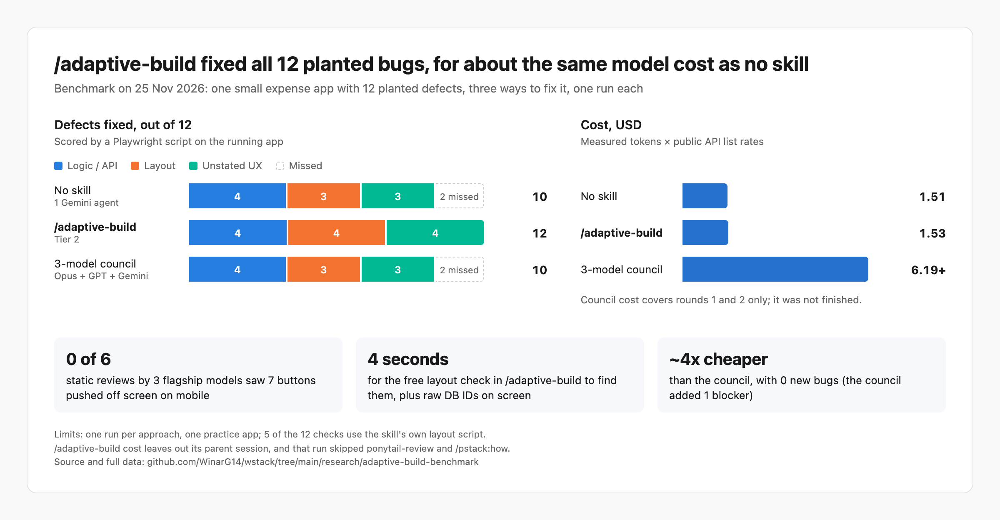
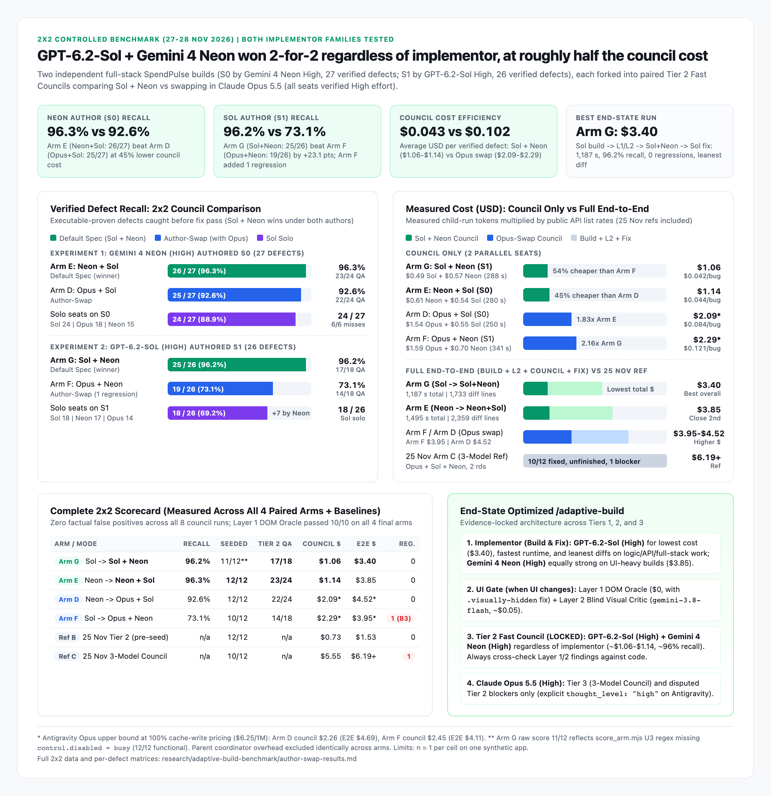

# wstack

Agent skills I use every day, cleaned up so anyone can use them. They work in Claude Code and Codex.
(Yes, the name is a nod to [tstack](https://github.com/t3dotgg/tstack).)

## Skills

| Skill | Say | What it does |
|---|---|---|
| [`adaptive-build`](skills/adaptive-build/SKILL.md) | "/adaptive-build &lt;task&gt;" or "/adaptive-build review &lt;PR&gt;" (plugin: `/wstack:adaptive-build`) | Picks the right amount of rigor for each change, then runs **one tool per job** from tstack, pstack and ponytail. Adds a USD 0 layout check and a blind visual critic, so UI bugs get caught before you look. |

## `adaptive-build`: one conductor for tstack, pstack and ponytail

Good skill packs exist. The hard part is knowing **which one to run, and when to stop**. If you run `/council` on a one-line fix, you waste USD 5. If you skip review on an auth change, you ship a bug. If you stack `sol-loop` on top of `council` on top of `interrogate`, three tools do the same job.

`adaptive-build` makes that choice for you:

1. **Triage first, for free.** `scripts/adaptive_triage.py` reads the real git diff in under 2 seconds and with zero tokens: file count, module spread, caller fan-out (`git grep`), API/DB/auth/config boundaries, async and concurrency primitives, UI files. It puts the change in a tier and prints what it will run and what it will skip.
2. **Three tiers, one role per tool, hard round caps.**

   | Tier | When | Build | Review |
   |---|---|---|---|
   | 1 LEAN (~USD 0.5-3) | 1-4 files, one module, no boundary | `ponytail` smallest diff | `ponytail-review` **or** one `sol-loop` (max 2 rounds) |
   | 2 TARGETED (~USD 2.5-6) | shared code, API/DB/auth, bug fix, async, 5-14 files | `/pstack:how` for real callers -> 5-bullet design lock -> `ponytail` (GPT-6.2-Sol High or Gemini 4 Neon High) | `ponytail-review` trim -> **2-model fast council locked to GPT-6.2-Sol High + Gemini 4 Neon High regardless of implementor** (max 2 rounds, cross-checking Layer 1/2) -> `/pstack:blast-radius` when risky |
   | 3 FULL (~USD 12-25) | 15+ files, state machines, security/money/migration, or 2 failed fixes | + `/pstack:architect`, `/pstack:statechart` | + full 3-model `/council` (Sol + Neon + Claude Opus 5.5 High, cap 3 rounds) or `/pstack:interrogate` |

   It escalates by itself when a Tier 1 change touches shared code or a contract. After two failed fixes in the same place it stops patching and tests the hidden assumption.
3. **It looks at the screen.** Static review reads code, not pixels. When UI files change it runs:
   - **Layer 1, USD 0:** `scripts/browser_audit.mjs` + `scripts/ui_geometry_audit.js` in headless Playwright at desktop and mobile widths. They fail on clipped text, dead gaps, horizontal overflow, controls off screen, overlapping buttons, console errors, failed requests, broken images, unlabeled controls, and raw IDs, ISO dates or `ENUM_KEYS` in the UI.
   - **Layer 2, about USD 0.04-0.20:** a fresh vision model sees only screenshots and the Layer 1 JSON, no code. It checks Nielsen's 10 heuristics and splits findings into **Bucket A** (fix now: no delete confirm, double submit, swallowed errors, dead-end empty states) and **Bucket B** (ranked ideas you approve one by one, so no scope creep).
   - **Layer 3 (Tier 3):** a short exploratory pass: fast tab switching, double clicks, long strings, reload, `Escape`.

### Research result

We ran one fault-seeded benchmark: a small expense app with 12 planted defects (4 logic/API, 4 layout, 4 unstated UX). Full write-up, per-seat token table and limits: [`research/adaptive-build-benchmark/`](research/adaptive-build-benchmark/README.md).



| | No skill | `/adaptive-build` (Tier 2) | Full 3-model `/council` |
|---|---|---|---|
| Defects fixed | 10 / 12 | **12 / 12** | 10 / 12 |
| Cost (measured tokens × list rates) | USD 1.51 | USD 1.53 | USD 6.19, not finished |
| Diff size | 1,252 lines | **749 lines** | 764 lines |
| New regressions | 0 | 0 | 1 blocker |

The short version: the same cost as no skill, all 12 fixed, and about 4x cheaper than the council. Six flagship static reviews missed 7 buttons off screen on mobile and raw DB IDs in the UI. The USD 0 DOM check found both in 4 seconds.

Caveats: one run per arm on one synthetic app. 5 of the 12 checks use the skill's own geometry script. The `/adaptive-build` cost leaves out its parent session, and that run skipped `ponytail-review` and `/pstack:how`. Read the [limits](research/adaptive-build-benchmark/README.md#limits-read-before-you-quote-the-numbers) before you quote it.

### Follow-up 2x2 study (27-28 Nov 2026): does Tier 2 need Opus when a council model wrote the code?

We ran a paired 2x2 extension testing **same-family self-review bias vs author-swap with Claude Opus 5.5 (High)** across both implementor families (**Gemini 4 Neon High** and **GPT-6.2-Sol High**) on fresh SpendPulse feature builds (Bulk Approve, Inline Reject with required reason, and filtered formula-safe CSV export). Full matrices and token tables: [`author-swap-results.md`](research/adaptive-build-benchmark/author-swap-results.md).



| Arm | Implementor | Fast Council (High) | Verified Recall | Council USD | End-to-End USD | Regressions |
|---|---|---|---:|---:|---:|---:|
| **Arm G (Default)** | GPT-6.2-Sol | **Sol + Neon** | **25/26 (96.2%)** | **$1.06** | **$3.40** | **0** |
| Arm F (Swap) | GPT-6.2-Sol | Opus + Neon | 19/26 (73.1%) | $2.29* | $3.95* | 1 (`B3`) |
| **Arm E (Default)** | Gemini 4 Neon | **Neon + Sol** | **26/27 (96.3%)** | **$1.14** | **$3.85** | **0** |
| Arm D (Swap) | Gemini 4 Neon | Opus + Sol | 25/27 (92.6%) | $2.09* | $4.52* | 0 |

Result: **GPT-6.2-Sol (High) + Gemini 4 Neon (High)** won 2-for-2 regardless of implementor (~96% recall at USD 1.06-1.14 council cost, zero regressions). Swapping in Claude Opus 5.5 cost roughly 2x more and, when replacing Sol (Arm F), dropped recall by 23.1 points and introduced a form contract regression. Tier 2 now explicitly locks in `Sol + Neon` and reserves Opus for Tier 3 and disputed blockers.

## Credits: the stacks it harmonizes, and how

`adaptive-build` writes none of these tools. It is the layer that decides **which one runs, when, and when to stop**. Each tool keeps one job, so no two tools do the same work on one change. All credit for the tools goes to their authors.

| Stack | By | What `adaptive-build` uses it for |
|---|---|---|
| [ponytail](https://github.com/DietrichGebert/ponytail) | Dietrich Gebert | `ponytail` writes the smallest complete diff on **every** tier. `ponytail-review` is the Tier 1 review and the cheap trim before any council on Tier 2 and 3. |
| [tstack](https://github.com/t3dotgg/tstack) | Theo Browne ([t3dotgg](https://github.com/t3dotgg)) | `sol-loop` is the Tier 1 option for tricky logic (max 2 rounds). `council` is the cross-provider review: 2 models on Tier 2, 3 models on Tier 3 (max 3 rounds). The repo layout of wstack copies tstack. |
| [pstack](https://github.com/cursor/plugins/tree/main/pstack) | Lauren Tan ([poteto](https://github.com/poteto)), Cursor | Tier 2: `how` (real callers and data owner), `why` (legacy code), `reframe` + `sharpen` (fuzzy briefs), `blast-radius` (prove the one safety fact by running code). Tier 3: `architect` (2 competing sketches), `statechart` (async and race logic), `interrogate` (repro-only review), `figure-it-out` (long unattended runs). Any tier: `benchmark-checklist` for numbers, `correct` when a bug class repeats. `arena` is skipped unless you ask. |
| [taste-skill](https://github.com/leonxlnx/taste-skill) | Leon Lin ([Leonxlnx](https://github.com/Leonxlnx)) | Optional `design-taste-frontend` for visual craft on marketing and brand pages. |
| [T3 Code](https://github.com/pingdotgg/t3code) | [Ping.gg](https://github.com/pingdotgg) | `delegate_task` runs the council seats on other providers' models. |

How the pieces fit on one change:

1. **Triage (bundled, USD 0):** `adaptive_triage.py` reads the diff and picks Tier 1, 2 or 3.
2. **Build:** `ponytail` always. On Tier 2 and 3, pstack runs first (`how`, then `architect` / `statechart` on Tier 3).
3. **Review:** `ponytail-review` trims, then `sol-loop` (Tier 1) or `council` (Tier 2 and 3), then `blast-radius` or `interrogate` when the risk is in back-end or shared code.
4. **Look at the screen (bundled):** Layer 1 layout check and the Layer 2 blind visual critic, when UI files change.
5. **Stop rules:** hard round caps, and after 2 failed fixes it stops and tests the hidden assumption.

The UX critic rubric uses [Nielsen's 10 usability heuristics](https://www.nngroup.com/articles/ten-usability-heuristics/). The cheap-first routing follows the cascade idea in [FrugalGPT](https://arxiv.org/abs/2305.05176) and [RouteLLM](https://arxiv.org/abs/2406.18665).

## Install

**Claude Code plugin (recommended, gets updates):**

```
/plugin install wstack --marketplace WinarG14/wstack
```

Older Claude Code (before 2.1.275): `/plugin marketplace add WinarG14/wstack`, then `/plugin install wstack@wstack`. As a plugin, the skill is `/wstack:adaptive-build`.

**Turn on auto-update once:** run `/plugin`, open **Marketplaces**, select `wstack`, and turn on auto-update. Claude Code keeps it off for marketplaces outside Anthropic's, and a marketplace cannot turn it on for you. The plugin has no fixed version, so every push to `main` reaches you.

**Codex plugin:** this repo also ships `.codex-plugin/plugin.json` and `.agents/plugins/marketplace.json`.

**Or copy the files:**

```bash
git clone https://github.com/WinarG14/wstack
cp -R wstack/skills/* ~/.claude/skills/   # Claude Code
cp -R wstack/skills/* ~/.codex/skills/    # Codex
```

**UI layers only:** `npm i -g playwright && npx playwright install chromium` (or install Playwright in your project).

`load_playwright.mjs` finds Playwright in the current project, `NODE_PATH`, or the global npm root. It uses Playwright's Chromium, or your installed Chrome if Chromium is not downloaded.

## Requirements

**Works on its own:** the triage script, Layer 1 (layout check) and the Layer 2/3 critic rubric. These need only `python3`, `git`, `node` and Playwright.

**Calls other skills by name.** `adaptive-build` conducts them. It does not copy them. Install the ones you want:

- [ponytail](https://github.com/DietrichGebert/ponytail): `ponytail`, `ponytail-review`
- [tstack](https://github.com/t3dotgg/tstack): `council`, `sol-loop`
- [pstack](https://github.com/cursor/plugins/tree/main/pstack): `how`, `why`, `architect`, `statechart`, `blast-radius`, `interrogate`, `reframe`, `sharpen`, `figure-it-out`, `correct`, `benchmark-checklist`
- Optional, for visual craft: [taste-skill](https://github.com/leonxlnx/taste-skill) (`design-taste-frontend`) or any UI review skill
- For the councils: a harness that can run models from other providers. [T3 Code](https://github.com/pingdotgg/t3code) does this with `delegate_task`.

If one is missing, the skill still runs. The triage output adds a `Not installed:` line under `RUN:`, and `SKILL.md` has a fallback row for each skill (for example: no `sol-loop` means one fresh reviewer from another model family, 2 rounds at most). The agent must say in its report which fallbacks it used. The full tier flow works best with all three packs installed.

## Make it yours

The model names in the councils (Gemini 4 Neon, GPT-6.2-Sol, Claude Opus 5.5) and the USD ranges are mine. Change them to the models you have. The risk patterns sit at the top of `adaptive_triage.py`, and the tier thresholds are in its `recommend()` function (search for `tier3_reasons`).

## License

[MIT](LICENSE)
