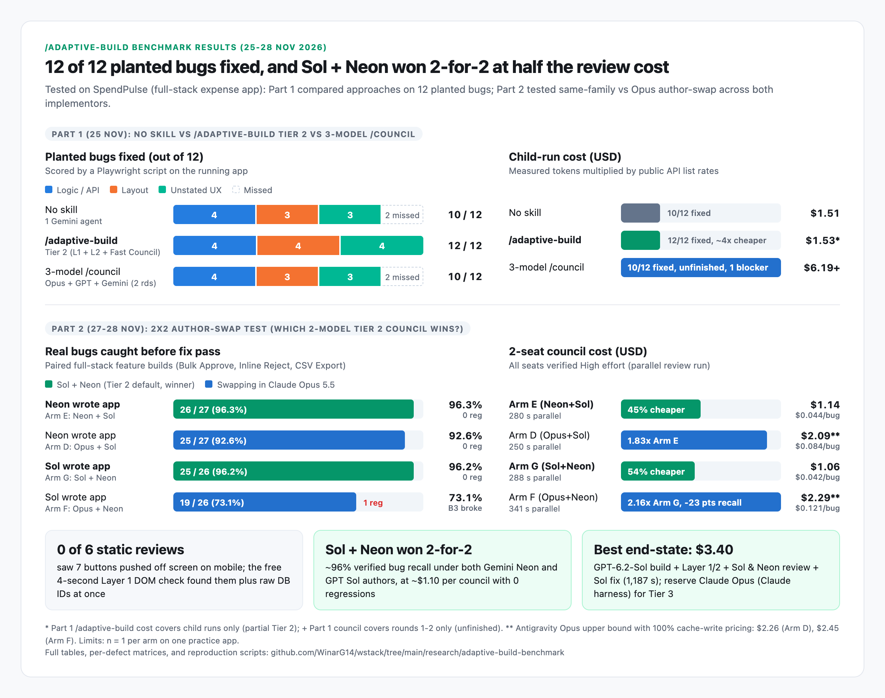
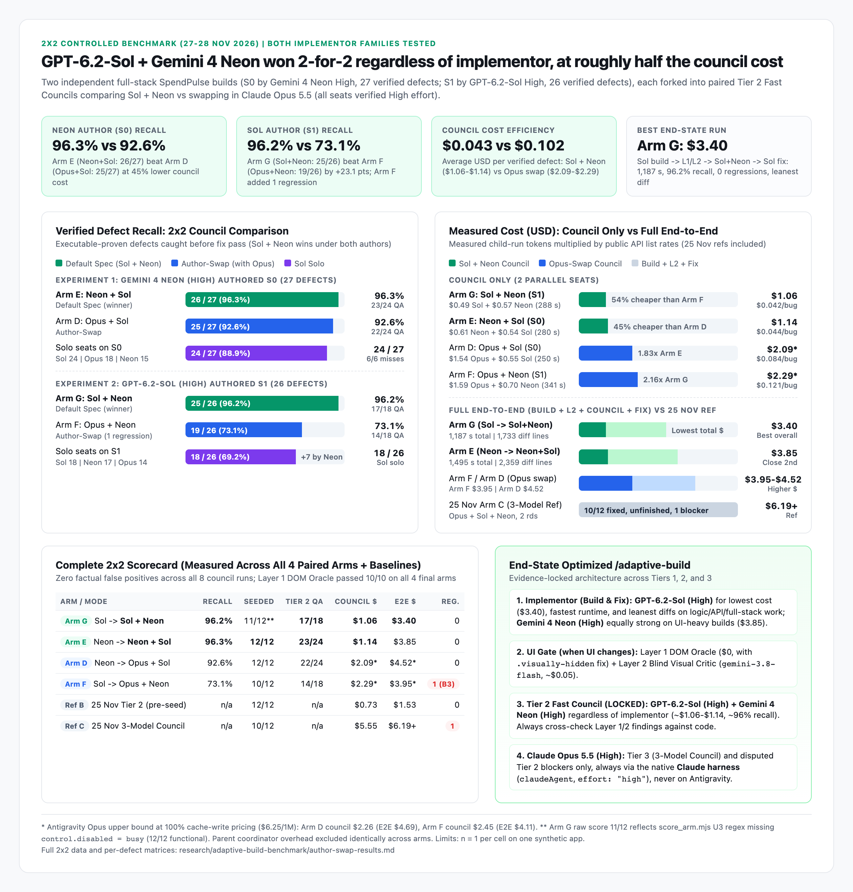

# Benchmark: no skill vs `/adaptive-build` vs full 3-model `/council`

Run on 25 Nov 2026. One fault-seeded app, three arms, one run per arm.

## Result in one line

`/adaptive-build` (Tier 2) fixed **12 of 12** seeded defects. The no-skill baseline and the full 3-model council each fixed **10 of 12**. `/adaptive-build` cost about the same as no skill (USD 1.53 vs USD 1.51) and about **4x less** than the council (USD 6.19, and the council was not finished).



Chart source: [`benchmark-summary.html`](benchmark-summary.html).

## Testbed

SpendPulse is a small expense and approval tracker: a Node HTTP API, plain HTML/CSS/JS, and a JSON file for storage. The source is in [`testbed/`](testbed/). It starts with **12 planted defects** (0 of 12 pass at baseline):

| Group | ID | Planted defect |
|---|---|---|
| Logic / state / API | B1 | Async filter race: a slow earlier response overwrites the tab the user picked last |
| | B2 | "Approved Spend" KPI counts rejected items and shows float noise |
| | B3 | Create form sends `requesterName`, the API expects `requester`; the error is swallowed |
| | B4 | Status + search filters use `else if`, so they do not combine; Approve saves `APPROVE` instead of `APPROVED` |
| Visual / layout geometry | V1 | A 56px banner with `opacity: 0` keeps its space (dead gap) |
| | V2 | Status pills clip their text (`max-width: 82px`) |
| | V3 | A fixed 960px toolbar overflows at 390px wide and pushes controls off screen |
| | V4 | Export and Reset buttons overlap (`margin-right: -22px`) |
| Unstated UX common sense | U1 | Delete runs at once, with no confirm and no undo |
| | U2 | Raw DB IDs (`exp_...`), raw ISO UTC dates and raw `PENDING_L2_APPROVAL` enums show in the UI |
| | U3 | Blank empty state with no way out; no disabled state while a request runs |
| | U4 | Primary button looks like secondary buttons; the modal ignores `Escape` |

## Arms

- **Arm A, no skill:** one Gemini 4 Neon (High) agent, told to find and fix what is wrong.
- **Arm B, `/adaptive-build` Tier 2:** triage script (USD 0) → Layer 1 DOM geometry check (USD 0) → Layer 2 blind visual critic on screenshots only (Gemini 3.8 Flash) → 2-model fast council (Gemini 4 Neon High + GPT-6.2-Sol High) → one `ponytail` fix pass → Layer 1 again.
- **Arm C, full `/council`:** Claude Opus 5.5 High + GPT-6.2-Sol High + Gemini 4 Neon High, static code review, two rounds, with a fix pass after round 1.

## Results

| | Arm A: no skill | Arm B: `/adaptive-build` | Arm C: 3-model `/council` |
|---|---|---|---|
| **Defects fixed (of 12)** | 10 | **12** | 10 |
| Logic / state / API (of 4) | 4 | 4 | 4 |
| Visual / geometry (of 4) | 3 (9 buttons off screen at 390px) | 4 | 3 (7 buttons off screen at 390px) |
| Unstated UX (of 4) | 3 (5 raw `exp_...` IDs left) | 4 | 3 (5 raw `exp_...` IDs left) |
| Active wall-clock time | 701 s | 615 s | 703 s, not finished (round 2 scored 7-8/10, so it needed another fix and round 3) |
| Model seats | 1 flagship | 3 flagship + 1 small vision model, no Opus | 7 flagship through round 2 (2 Opus) |
| Tokens (measured) | 1,486,038 | 1,174,372 | 4,228,146 |
| Cost at API list rates | USD 1.51 | USD 1.53 | USD 6.19 (round 1 + 2 only) |
| Diff size (`git diff --shortstat`) | +1,033 / -219 | +624 / -125 | +604 / -160 (after round 1) |
| New regressions | 0 | 0 (bad JSON now returns HTTP 400) | 1 blocker: the round 1 `readBody` edit hangs on bad JSON |
| Scope control | Added an unrequested Reject API | Fixes in Bucket A, 4 ranked ideas in Bucket B | No structured ideas list |

Scores come from [`score_arm.mjs`](score_arm.mjs), a Playwright script that checks each of the 12 defects on the running app. Per-arm output is in [`evidence/`](evidence/).

### Token and cost detail

Tokens come from the session logs of every child run (Claude, Codex and Antigravity transcripts). Dollar figures are those tokens multiplied by public API list rates. They are not invoices.

| Arm | Part | Uncached in | Cache read | Cache write | Out | Total | USD |
|---|---|---:|---:|---:|---:|---:|---:|
| A | One Gemini 4 Neon High run (49 steps) | 135,884 | 1,267,867 | 0 | 82,287 | 1,486,038 | 1.51 |
| B | Layer 1 DOM check (script) | 0 | 0 | 0 | 0 | 0 | 0.00 |
| B | Layer 2 blind visual critic (Gemini 3.8 Flash) | 51,276 | 39,263 | 0 | 7,853 | 98,392 | 0.04 |
| B | Fast council seat 1 (Gemini 4 Neon High) | 57,597 | 86,896 | 0 | 25,727 | 170,220 | 0.44 |
| B | Fast council seat 2 (GPT-6.2-Sol High) | 50,276 | 212,352 | 0 | 7,540 | 270,168 | 0.29 |
| B | `ponytail` fix + Layer 1 re-check (Gemini 4 Neon) | 101,360 | 495,914 | 0 | 38,318 | 635,592 | 0.76 |
| C | R1 seat 1 (Claude Opus 5.5 High) | 16 | 637,246 | 216,657 | 14,036 | 867,955 | 2.02 |
| C | R1 seat 2 (GPT-6.2-Sol High) | 52,755 | 211,072 | 0 | 9,553 | 273,380 | 0.33 |
| C | R1 seat 3 (Gemini 4 Neon High) | 60,450 | 127,315 | 0 | 24,295 | 212,060 | 0.44 |
| C | R1 fix pass (Gemini 4 Neon High) | 87,753 | 453,264 | 0 | 30,806 | 571,823 | 0.64 |
| C | R2 seat 1 (Claude Opus 5.5 High) | 22 | 1,032,619 | 201,391 | 9,690 | 1,243,722 | 2.02 |
| C | R2 seat 2 (GPT-6.2-Sol High) | 51,963 | 364,416 | 0 | 3,224 | 419,603 | 0.27 |
| C | R2 seat 3 (Gemini 4 Neon High) | 91,950 | 532,276 | 0 | 15,377 | 639,603 | 0.48 |

Rates used, USD per 1M tokens (in / cache read / cache write / out): Claude Opus 5.5 5 / 0.50 / 6.25 / 25; GPT-6.2-Sol 2.50 / 0.25 / 0 / 15; Gemini 4 Neon 2.00 / 0.20 / 0 / 12; Gemini 3.8 Flash 0.30 / 0.03 / 0 / 2.50.

## What we think it shows

1. **Static review does not see pixels.** Two rounds of three flagship reviewers (6 reviews) did not flag the 7 Approve/Delete buttons off screen at 390px, or the raw `exp_8a14c2f9` IDs. The USD 0 DOM check found both in about 4 seconds. The blind visual critic confirmed the 8 visual and UX issues in about 72 seconds, with no code context.
2. **No structure means drift.** The no-skill agent took longer, wrote about 1.7x more diff, added a feature nobody asked for, and wrote its own check that still passed with 9 buttons off screen.
3. **Two providers were enough for the logic bugs.** On this app, the Gemini + GPT fast council caught the same logic, contract and API bugs as the 3-model council. Most of the council's cost was the two Opus seats (USD 4.04 of 6.19).
4. **Small edits stay cheap.** On a 1-file helper change, `adaptive_triage.py` routes to Tier 1 (`ponytail` + `ponytail-review`) and skips the council.

## Limits (read before you quote the numbers)

- **n = 1.** Each arm ran once on one small synthetic app. Treat the numbers as a direction, not a measurement of the general case.
- **The scorer shares code with Arm B.** `score_arm.mjs` uses the skill's own `ui_geometry_audit.js` for 5 of the 12 checks (V1-V4 and U2). The two defects that only Arm B fixed (V3 and U2) are both in that group. The screenshots in [`evidence/`](evidence/) show the defects are real (buttons off screen, raw IDs on screen), but an independent scorer would make this stronger.
- **Arm C is not finished.** Its defect score is from after round 1. Its cost covers rounds 1 and 2. A full round 3 would add cost and might fix more.
- **Parent-session overhead is not counted** for Arm B or Arm C (the session that ran the triage and launched the child runs). Arm A is one session, so its count includes everything.
- **Arm B was a partial Tier 2.** It ran the triage, Layer 1, Layer 2, the 2-model fast council and one `ponytail` fix pass. It did not run `ponytail-review` or `/pstack:how`. A full Tier 2 run would cost more.
- **Two scorer checks are weak.** U3's double-submit guard is a regex on `app.js`, not a click test. U1 passes when the row count does not change after Delete, so a broken Delete button would also pass.
- **The scripts changed after the run.** On 27 Nov 2026 the Playwright loader, the browser launch and the way the oracle is injected changed for portability. The scoring logic did not change, and the untouched testbed still scores 0 of 12.
- The planted defects were chosen by the same person who built the skill. A blind defect set from someone else is the obvious next step.

## Reproduce

```bash
npm i -g playwright && npx playwright install chromium
# give each arm a fresh copy of testbed/, let it work, then score it
# (the scorer starts the arm's server on --port by itself):
cp -R research/adaptive-build-benchmark/testbed /tmp/arm-x
node research/adaptive-build-benchmark/score_arm.mjs --arm-dir /tmp/arm-x --port 4151 --out /tmp/arm-x-evidence
```

Design notes behind the skill (expert terms, neighbour fields, the sharpened brief): [`design-notes.md`](design-notes.md).

## Follow-up: 2x2 Author-Swap Experiment (27-28 Nov 2026)

Because Arm B above audited a pre-seeded app before Neon wrote code, we ran a controlled 2x2 follow-up testing **same-family self-review bias vs swapping in Claude Opus 5.5 (High)** across both **Gemini 4 Neon (High)** and **GPT-6.2-Sol (High)** implementors on fresh full-stack feature builds (Bulk Approve, Inline Reject with required reason, and filtered formula-safe CSV export).



- **Winner under both authors:** **GPT-6.2-Sol (High) + Gemini 4 Neon (High)** achieved **96.3%** recall on Neon-authored code (USD 1.14 council vs USD 2.09 for Opus + Sol) and **96.2%** recall on Sol-authored code (USD 1.06 council vs USD 2.29 and 73.1% recall for Opus + Neon, which also introduced 1 regression).
- **Best end-state mode:** GPT-6.2-Sol (High) build + Layer 1/2 + Sol & Neon Tier 2 Fast Council + Sol fix (**USD 3.40** end-to-end, 0 regressions).
- Full per-defect matrices, 16-run token accounting, and end-state architecture: [`author-swap-results.md`](author-swap-results.md) and [`author-swap-experiment.html`](author-swap-experiment.html).
