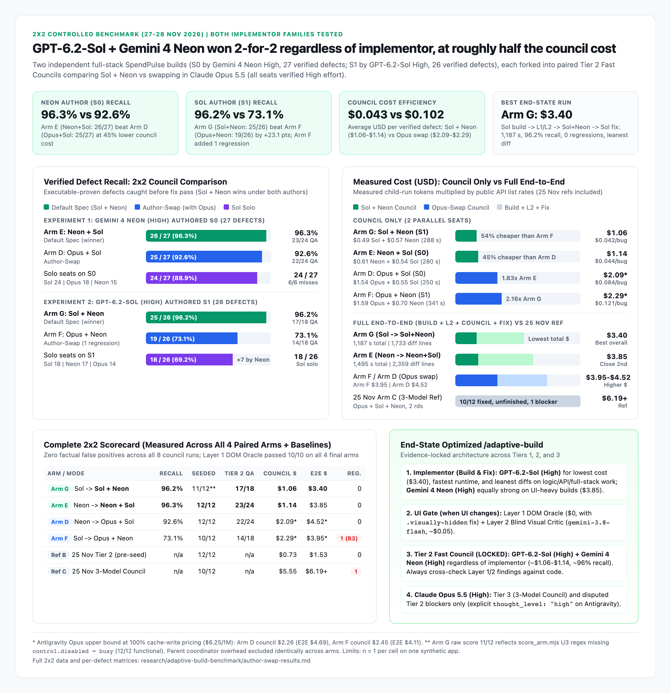

# 2x2 Author-Swap Benchmark: Same-Family vs Cross-Family Fast Council

Run on 27-28 Nov 2026. Controlled 2x2 paired extension of the 25 Nov 2026 [`/adaptive-build` benchmark](README.md) testing whether **same-family self-review bias** requires swapping **Claude Opus 5.5 (High)** into the Tier 2 **2-Model Fast Council**, across **both** implementor families (**Gemini 4 Neon High** and **GPT-6.2-Sol High**).

Chart source: [`author-swap-experiment.html`](author-swap-experiment.html).

---

## Executive Verdict (Measured)

**Hypothesis tested:** Is **GPT-6.2-Sol (High) + Gemini 4 Neon (High)** the best Tier 2 Fast Council reviewer pairing **regardless of which model authored the code**?

**Answer: YES, confirmed 2-for-2 across both implementor families (measured).**

1. **When Gemini 4 Neon (High) authored `S0` (27 verified defects):**
   - **Arm E (`Neon + Sol`, Default Spec)** caught **26 / 27 (96.3%)** at **USD 1.14** council cost (USD 0.044 per defect), passed **12 / 12** original defects, **10 / 10** Layer 1 states, and **23 / 24** Tier 2 checks with **0 regressions**.
   - **Arm D (`Opus + Sol`, Author-Swap)** caught **25 / 27 (92.6%)** at **USD 2.09** council cost (upper bound USD 2.26; **1.83x** Arm E), passed **12 / 12** original defects, **10 / 10** Layer 1 states, and **22 / 24** Tier 2 checks with **0 regressions**.
   - Solo self-review bias existed (Neon solo 15/27 vs Opus solo 18/27), yet GPT-6.2-Sol (24/27 in both runs) independently closed **100%** of Neon's 6 solo blind spots.
2. **When GPT-6.2-Sol (High) authored `S1` (26 verified defects):**
   - **Arm G (`Sol + Neon`, Default Spec)** caught **25 / 26 (96.2%)** at **USD 1.06** council cost (USD 0.042 per defect), passed **11 / 12** raw scorer checks (**12 / 12** functional; `U3` regex miss on `control.disabled = busy`), **10 / 10** Layer 1 states, and **17 / 18** Tier 2 checks with **0 regressions**, achieving the **lowest end-to-end cost of all 4 arms (USD 3.40)**.
   - **Arm F (`Opus + Neon`, Author-Swap)** dropped to **19 / 26 (73.1%)** recall at **USD 2.29** council cost (upper bound USD 2.45; **2.16x** Arm G, **2.88x** worse cost per defect at USD 0.121), passed **14 / 18** Tier 2 checks, and introduced **1 real contract regression** (`B3` create-expense contract broke because Opus Nit N10 added an empty required `"Select category"` dropdown option).
   - GPT-6.2-Sol showed **strong self-review rigor** on its own code (18/26 solo, beating Opus solo 14/26), while Gemini 4 Neon closed **7 of Sol's 8 misses** (CSV schema columns, URI decoding, sticky server reject error, empty-state copy, modal exits, mobile touch target, and initial feedback class).
3. **End-State Optimized Mode (Measured + Opinion):**
   - **Locked Tier 2 Fast Council (regardless of implementor):** **GPT-6.2-Sol (High) + Gemini 4 Neon (High)** paired with Layer 1 DOM Oracle (USD 0) and Layer 2 Blind Visual Critic (`gemini-3.8-flash`, USD 0.05), where the council explicitly cross-checks Layer 1/2 reports against code.
   - **Optimal Implementor + Pipeline:** **GPT-6.2-Sol (High) implementor + `Sol + Neon` Tier 2 Fast Council (Arm G)** delivered the best overall cost-speed-leanliness profile (**USD 3.40** end-to-end, **1,187 s**, `+1,309 / -424` diff, 96.2% defect recall, 0 regressions). **Gemini 4 Neon (High) implementor + `Neon + Sol` Tier 2 Fast Council (Arm E)** was a close second (**USD 3.85**, 1,495 s, 96.3% recall, 12/12 raw scorer, 0 regressions) with slightly stronger initial user interface (UI) polish before review.
   - **Claude Opus 5.5 (High) role:** Reserve strictly for **Tier 3 (3-Model Council)** and **disputed Tier 2 blockers**. Do not swap Sol or Neon out for Opus on Tier 2.

---

## Complete 2x2 Summary Table (with 25 Nov Baseline Context)

All values are **measured** from live runs, Playwright verifiers, and session token logs (`statev2.sqlite` + Codex JSON Lines [JSONL]) unless marked **inferred**.

| Arm / Configuration | Implementor | Fast Council (High Effort) | Council Recall | Council Cost (USD) | USD / Defect | Council Wall Clock | Post-Build Review + Fix (USD) | End-to-End Cost (USD) | Seeded (of 12) | Layer 1 (of 10) | Tier 2 Verifier | Regressions |
|---|---|---|---:|---:|---:|---:|---:|---:|---:|---:|---:|---:|
| **Arm D (Swap)** | Gemini 4 Neon | Opus + Sol | 25/27 (92.6%) | $2.09* | $0.084 | 249.7 s | $3.56* | $4.52* | 12/12 | 10/10 | 22/24 (91.7%) | 0 |
| **Arm E (Default)** | Gemini 4 Neon | **Neon + Sol** | **26/27 (96.3%)** | **$1.14** | **$0.044** | 279.8 s | **$2.88** | **$3.85** | **12/12** | **10/10** | **23/24 (95.8%)** | **0** |
| **Arm F (Swap)** | GPT-6.2-Sol | Opus + Neon | 19/26 (73.1%) | $2.29* | $0.121 | 340.5 s | $3.07* | $3.95* | 10/12 | 10/10 | 14/18 (77.8%) | **1 (`B3`)** |
| **Arm G (Default)** | GPT-6.2-Sol | **Sol + Neon** | **25/26 (96.2%)** | **$1.06** | **$0.042** | **287.6 s** | **$2.51** | **$3.40** | **11/12\*\*** | **10/10** | **17/18 (94.4%)** | **0** |
| *Ref A (25 Nov)* | *Gemini 4 Neon* | *None (no skill)* | *n/a* | *n/a* | *n/a* | *n/a* | *$1.51* | *$1.51* | *10/12* | *FAIL* | *n/a* | *0* |
| *Ref B (25 Nov)* | *Pre-seeded* | *Neon + Sol (Tier 2)* | *n/a* | *$0.73* | *n/a* | *~180 s* | *$1.53* | *n/a* | *12/12* | *PASS* | *n/a* | *0* |
| *Ref C (25 Nov)* | *Pre-seeded* | *Opus + Sol + Neon (2 rds)* | *n/a* | *$5.55* | *n/a* | *~530 s* | *$6.19+* | *n/a* | *10/12* | *FAIL* | *n/a* | *1 blocker* |

*\*Antigravity Agent Client Protocol (ACP) telemetry folds Claude Opus 5.5 cache-write tokens into uncached input. Pricing at USD 5.00/1M gives USD 1.54 (Arm D) and USD 1.59 (Arm F); upper bound if 100% were priced at Anthropic's USD 6.25/1M cache-write rate is USD 1.71 (Arm D council USD 2.26, post-`S0` USD 3.72) and USD 1.75 (Arm F council USD 2.45, post-`S1` USD 3.23).*
*\*\*Arm G scored 11/12 on raw `score_arm.mjs` strictly because `U3` checks regex `/\.disabled\s*=\s*true|isSubmitting|inFlight/i` in `app.js`, whereas Sol wrote `control.disabled = busy` (functional disable guard works in live browser testing: 12/12 functional).*

---

## Experimental Protocol

Both halves of the 2x2 study followed the exact same isolated, paired workflow:

1. **Verified High effort on every flagship seat** (`statev2.sqlite` -> `orchestration_v2_projection_subagents`):
   - `claude-opus-5-5` (`antigravity`): `thought_level: "high"` (explicit override from Antigravity's `medium` default)
   - `gemini-4-neon` (`antigravity`): `thought_level: "high"`
   - `llm-gateway--gpt-6.2-sol` (`codex`): `reasoningEffort: "high"`
   - `gemini-3.8-flash` (`antigravity`, Layer 2 Blind Visual Critic): `thought_level: "medium"`
2. **Shared author snapshots (`S0` by Neon High; `S1` by Sol High):** Each implementor started from an untouched copy of `testbed/` with zero knowledge of the 12-defect answer key and zero Layer 1/2 feedback. Both received the exact same prompt: fix all existing SpendPulse bugs/layout/usability issues and implement three realistic Tier 2 full-stack features using `ponytail` discipline:
   - **Bulk Approve:** pending-row checkboxes + "Approve Selected" with partial-failure handling.
   - **Inline Reject with required reason:** `POST /api/expenses/:id/reject` persisting `REJECTED` + reason, blank-reason validation, and visible reason display.
   - **Working CSV Export:** Comma-Separated Values (CSV) export matching active status tab + active search query with formula-injection protection (`=`, `+`, `-`, `@`, whitespace/tab/carriage return).
3. **Shared Layer 1 + Layer 2 audits:** Both `S0` and `S1` were scored with `score_arm.mjs`, audited across 10 desktop (`1440x900`) and mobile (`390x844`) states via Layer 1 Document Object Model (DOM) Oracle (`browser_audit.mjs`), and reviewed cold (screenshots + Layer 1 JSON only, zero code) by Layer 2 Blind Visual Critic (`gemini-3.8-flash`).
4. **Identical paired forks:** `S0` forked byte-for-byte into Arm D (`Opus + Sol`) and Arm E (`Neon + Sol`); `S1` forked byte-for-byte into Arm F (`Opus + Neon`) and Arm G (`Sol + Neon`). All 4 council seats per experiment ran independently with identical read-only prompts.
5. **Executable proof + paired fix passes:** Candidate defects were live-reproduced against `S0` (`verify_s0_repros.mjs`) and `S1` (`verify_s1_repros.mjs`) via Node Hypertext Transfer Protocol (HTTP), raw Transmission Control Protocol (TCP), and Playwright before counting. Each arm then ran an identical fresh `ponytail` fix pass (Neon High fixing Neon's `S0` in Arms D/E; Sol High fixing Sol's `S1` in Arms F/G) fed strictly its own council + Layer 1/2 reports, followed by deterministic end-to-end verification (`score_arm.mjs`, Layer 1 `browser_audit.mjs`, and Tier 2 edge-case verifiers).

---

## Part 1: Neon-as-Author (`S0` -> Arm D vs Arm E, 27 Verified Defects)

`S0` (`+1,276 / -157` lines) scored **10 / 12** on `score_arm.mjs` (missing `U1` one-click delete and `U2` 5 raw `exp_...` IDs) and failed 9/10 Layer 1 states on those raw IDs (0 geometry failures). Layer 2 (`gemini-3.8-flash`) returned `FAIL` with 1 factual false positive (`A5` mistook `placeholder="125.00"` for a pre-filled value) and 1 misclassified Bucket B item (`B2` delete confirmation). All 4 flagship reviewers refuted `A5` and promoted `B2`.

| ID | Sev | Category | Verified Defect in `S0` (Live-Proven) | Arm D: Opus | Arm D: Sol | Arm E: Neon | Arm E: Sol | Arm D Fixed? | Arm E Fixed? |
|---|---|---|---|:-:|:-:|:-:|:-:|:-:|:-:|
| D01 | P1 | Security / API | Malformed `Host` header kills Node server (`ERR_INVALID_URL`, exit 1) | Yes | Yes | Yes | Yes | Yes | Yes |
| D02a | P1 | Logic / API | Sub-cent amount (`0.004`) persists as `$0.00` (HTTP 201) | Yes | Yes | Yes | Yes | Yes | Yes |
| D02b | P1 | Logic / API | Amount coercion accepts boolean (`true` -> `1`) and `1e308` -> `null` | Yes | Yes | **No** | Yes | Yes | Yes |
| D03 | P1 | State / UX | Open inline reject steals focus from `#searchInput` on every keystroke | Yes | Yes | Yes | Yes | Yes | Yes |
| D04 | P1 | UX (`U1`) | One-click permanent Delete with no confirm/undo | Yes | Yes | Yes | Yes | Yes | Yes |
| D05 | P1 | UX (`U2`) | Raw `exp_...` IDs in table, mobile cards, and bulk/delete banners | Yes | Yes | Yes | Yes | Yes | Yes |
| D06 | P1 | Security | Cross-Site Request Forgery (CSRF): `POST` accepts `text/plain` + cross-site `Origin` | Yes | Yes | **No** | Yes | Yes | Yes |
| D07 | P1 | State / Race | Stale selection allows Bulk Approve during delayed switch to `Approved` tab | **No** | Yes | **No** | Yes | Yes | Yes |
| D08 | P1 | State / Race | Delayed rejection on Row A wipes Row B's open draft | **No** | Yes | Yes | Yes | Yes | Yes |
| D09 | P1 | State / Race | Failed post-bulk refresh (HTTP 500) overwritten by green success banner | **No*** | Yes | Yes | Yes | Yes | Yes |
| D10 | P2 | State / Race | Modal Cancel/Escape during save lets earlier response close/clear reopened modal | **No** | Yes | **No** | Yes | Yes | Yes |
| D11 | P2 | Logic / API | Split multi-byte UTF-8 corrupts to `\uFFFD`; >1 MB resets TCP socket (no HTTP 413) | Yes | Yes | Yes | Yes | Yes | Yes |
| D12 | P2 | Logic / API | Non-atomic `writeFileSync`; storage errors return HTTP 400 leaking internal message | Yes | Yes | **No** | Yes | Yes | Yes |
| D13 | P2 | Logic / API | Legacy `APPROVE` status records omitted from `Approved` tab/KPIs/CSV | **No** | Yes | **No** | Yes | Yes | Yes |
| D14 | P2 | Security | No text length caps (500,000-char title accepted with HTTP 201) | Yes | Yes | **No** | Yes | Yes | Yes |
| D15 | P2 | UX | Key Performance Indicator (KPI) cards change with active tab without scope cue | Yes | Yes | **No** | Yes | Yes | Yes |
| D16 | P2 | UX | Seeded rejected row (`exp_1b44e8d1`) shows no reason indicator | Yes | Yes | **No** | Yes | Yes | Yes |
| D17 | P2 | State / UX | Typing search silently drops hidden selected pending rows (`2` -> `1`) | **Yes** | **No** | **No** | **No** | **Yes** | **No** |
| D18 | P2 | Visual / UX | Desktop pending rows wrap actions (49 vs 81 px); Reject shifts table 21.5 px | Yes | Yes | Yes | Yes | Yes | Yes |
| D19 | P2 | Accessibility | Modal does not trap Tab focus or restore focus on Escape | Yes | Yes | Yes | Yes | Yes | Yes |
| D20 | P2 | Visual / UX | Long unbroken title causes 361 px horizontal overflow at 390x844 | **No** | Yes | Yes | Yes | Yes | Yes |
| D21 | P2 | UX | Empty state lacks inline Reset CTA and mislabels unfiltered empty dataset | Yes | Yes | Yes | **No** | Yes | Yes |
| D22a | P2 | Visual / UX | Mobile 390 px tall stacked KPIs + redundant `Select` / `Expense` rows | Yes | Yes | Yes | Yes | Yes | Yes |
| D22b | P2 | Visual / UX | Mobile `Approved`/`Rejected` tabs render dead disabled `Select all` card | **No** | **No** | **Yes** | **Yes** | **No** | **Yes** |
| D23 | P2 | Accessibility | Accessible Rich Internet Applications (ARIA) tabs ignore Arrow keys | **No** | Yes | **No** | Yes | Yes | Yes |
| D24 | Nit | Logic / API | Static file fallback serves assets on `POST` / `DELETE` (200 instead of 405) | **No** | **No** | **Yes** | **No** | **No** | **Yes** |
| D25 | P2 | Logic / API | 32-bit random ID without uniqueness check; `DELETE` removes all colliding rows | **No** | Yes | **No** | Yes | Yes | Yes |
| **Total** | | | **27 verified defects in `S0`** | **18 / 27** | **24 / 27** | **15 / 27** | **24 / 27** | **25 / 27** | **26 / 27** |

*\*Opus N6 flagged active row Approve buttons mid-batch but missed the swallowed HTTP 500 refresh error.*

---

## Part 2: Sol-as-Author (`S1` -> Arm F vs Arm G, 26 Verified Defects)

`S1` (`+1,068 / -414` lines) scored **8 / 12** raw on `score_arm.mjs` (true misses: `U1` one-click delete and `U2` 5 raw `exp_...` IDs; scorer artifacts: `V2` flagged `span.visually-hidden` 1px screen-reader text as clipped, and `U3` regex missed `control.disabled = busy`). Layer 2 (`gemini-3.8-flash`) returned `FAIL` with 1 false positive (`A7` claimed no dedicated checkbox column) and 2 Bucket B items that belonged in Bucket A (`B2` delete confirmation and `B1` legacy rejected reason fallback). All 4 flagship reviewers caught both the Layer 1 `.visually-hidden` false positive and Layer 2 `A7`.

| ID | Sev | Category | Verified Defect in `S1` (Live-Proven) | Arm F: Opus | Arm F: Neon | Arm G: Sol | Arm G: Neon | Arm F Fixed? | Arm G Fixed? |
|---|---|---|---|:-:|:-:|:-:|:-:|:-:|:-:|
| R01 | P1 | UX (`U1`) | One-click permanent Delete with no confirmation | Yes | Yes | Yes | Yes | Yes | Yes |
| R02 | P1 | UX (`U2`) | Raw `exp_...` IDs under titles and in bulk feedback bullets | Yes | Yes | Yes | Yes | Yes | Yes |
| R03 | P1 | Security | CSRF unprotected (`text/plain` + cross-site `Origin` accepted on writes) | Yes | **No** | Yes | **No** | Yes | Yes |
| R04 | P1 | Logic / API | Sub-cent `0.001` persists, `1e308` accepted, raw float KPI addition | **No** | Yes* | Yes | Yes* | Partial (`1e308` left) | **Yes** |
| R05 | P1 | State / Race | Lost-response bulk approval reports `"1 approved. 1 failed."` after both persisted | **No** | **No** | **Yes** | **No** | **No** | **Yes** |
| R06 | P1 | Logic / API | CSV export omits `createdAt` and `rejectionReason` (`String(undefined)` bug) | Yes | Yes | **No** | Yes | Yes | Yes |
| R07 | P1 | Visual / UX | Mobile 390 px search placeholder clipped mid-word (`"categ"`) | Yes | Yes | Yes | Yes | Yes | Yes |
| R08 | P1 | Visual / UX | Mobile 390 px 3-column KPI wrapping misalignment and `$10k+` mid-number break | Yes | Yes | Yes | Yes | Yes | Yes |
| R09 | P2 | State / Race | Typed rejection draft silently lost on search or other row action | Yes | **No** | Yes | **No** | Yes | Yes |
| R10 | P2 | Logic / API | Zero-width space (`U+200B`) bypasses blank rejection validation (HTTP 200) | **No** | **No** | **Yes** | **No** | **No** | **Yes** |
| R11 | P2 | State / Race | Stalled request locks entire UI including modal Cancel and Escape | **No** | **No** | **Yes** | **No** | **No** | **Yes** |
| R12 | P2 | Security / API | Unbounded text lengths (500 KB accepted); >1 MB returns HTTP 400 instead of 413 | Yes | Yes | Yes | Partial (413) | Yes | Yes |
| R13 | P2 | State / Race | Multi-instance fixed `.tmp` file (`data.json.tmp`) rename race | **No** | **No** | **Yes** | **No** | **No** | **Yes** |
| R14 | P2 | Logic / API | 32-bit random ID (`randomBytes(4)`) collision without uniqueness check | **No** | **No** | **Yes** | **No** | **No** | **Yes** |
| R15 | P2 | Logic / API | Non-JSON 502 error dumps raw `SyntaxError` into UI banner | Yes | Yes | Yes | Yes | Yes | Yes |
| R16 | P2 | UX | Seeded rejected row (`exp_1b44e8d1`) shows no reason fallback | Yes | **No** | Yes | Yes | Yes | Yes |
| R17 | P2 | State / UX | Server reject error sticks after typing (`aria-invalid` missing on server error) | **No** | Yes | **No** | Yes | Yes | Yes |
| R18 | P2 | UX | Empty state lacks inline Reset CTA and mislabels zero-item dataset | Partial (CTA) | Yes | **No** | Yes | Yes | Yes |
| R19 | P2 | Visual / UX | Desktop reject panel misaligned/narrow and weak outlined `Confirm Rejection` CTA | Yes | Yes | Yes | Yes | Yes | Yes |
| R20 | P2 | UX | Modal missing `x` close icon, backdrop click dismiss, and form reset on cancel | Partial (`x`) | Yes | **No** | Yes | Yes | Yes |
| R21 | P2 | Visual / UX | Mobile checkbox touch target undersized (`24x26 px` vs 40 px buttons) | **No** | Yes | **No** | Yes | Yes | Yes |
| R22 | P2 | Logic / API | Encoded expense ID returns 404 (server missing `decodeURIComponent`) | **No** | **No** | **No** | **Yes** | **No** | **Yes** |
| R23 | P2 | UX | `Escape` does not close open inline reject form | **Yes** | **No** | **No** | **No** | **Yes** | **No** |
| R24 | P2 | Accessibility | Mobile 7-vs-8 table column mismatch, unnamed `Delete` buttons, focus jump to top | **No** | **No** | **Yes** | **No** | **No** | **Yes** |
| R25 | P2 | UX | Export CSV has no scope cue and downloads header-only file on zero matches | **No** | **No** | Yes | Partial (0-row) | **No** | **Yes** |
| R26 | Nit | Visual / UX | Clean `load()` sets `feedback error` class; empty row lacks `role="row"`/`cell` | **No** | Yes | **No** | Yes | Yes | Yes |
| **Total** | | | **26 verified defects in `S1`** | **14 / 26** | **15 / 26** | **18 / 26** | **17 / 26** | **18 / 26 (+1 reg)** | **25 / 26 (0 reg)** |

*\*Neon caught sub-cent `0.001` and float drift in `R04`, missing `1e308` upper bound (which Arm F left unfixed: `S02` failed on `huge: 201`).*

---

## Complete Measured Token, Cost, and Latency Table (All 16 Child Runs)

**API list rates (identical to 25 Nov `README.md`, USD per 1M tokens: uncached in / cache read / cache write / out):**
Claude Opus 5.5 `5.00 / 0.50 / 6.25 / 25.00`; GPT-6.2-Sol `2.50 / 0.25 / 0 / 15.00`; Gemini 4 Neon `2.00 / 0.20 / 0 / 12.00`; Gemini 3.8 Flash `0.30 / 0.03 / 0 / 2.50`.

| Experiment | Child Run (Verified Model & Effort) | Wall Clock | Uncached In | Cache Read | Output | Total Tokens | Cost (USD) |
|---|---|---:|---:|---:|---:|---:|---:|
| Neon-Author (`S0`) | Build `S0` (Gemini 4 Neon, `high`) | 455.7 s | 104,466 | 764,975 | 50,040 | 919,481 | 0.96 |
| Neon-Author (`S0`) | Layer 2 Critic (Gemini 3.8 Flash, `medium`) | 103.8 s | 58,288 | 94,066 | 11,365 | 163,719 | 0.05 |
| Arm D (Swap) | Council Seat 1 (Claude Opus 5.5, `high`) | 212.9 s | 133,857 | 798,271 | 18,866 | 950,994 | 1.54* |
| Arm D (Swap) | Council Seat 2 (GPT-6.2-Sol, `high`) | 249.7 s | 87,970 | 666,604 | 10,853 | 765,427 | 0.55 |
| Arm D (Swap) | Fix Pass (Gemini 4 Neon, `high`) | 612.7 s | 160,512 | 1,576,352 | 65,115 | 1,801,979 | 1.42 |
| Arm E (Default) | Council Seat 1 (Gemini 4 Neon, `high`) | 279.8 s | 94,225 | 292,226 | 30,185 | 416,636 | 0.61 |
| Arm E (Default) | Council Seat 2 (GPT-6.2-Sol, `high`) | 238.6 s | 87,949 | 608,240 | 10,871 | 707,060 | 0.54 |
| Arm E (Default) | Fix Pass (Gemini 4 Neon, `high`) | 655.5 s | 177,929 | 2,174,314 | 74,975 | 2,427,218 | 1.69 |
| Sol-Author (`S1`) | Build `S1` (GPT-6.2-Sol, `high`) | 336.3 s | 77,612 | 1,553,625 | 20,160 | 1,651,397 | 0.88 |
| Sol-Author (`S1`) | Layer 2 Critic (Gemini 3.8 Flash, `medium`) | 109.3 s | 58,894 | 40,632 | 11,990 | 111,516 | 0.05 |
| Arm F (Swap) | Council Seat 1 (Claude Opus 5.5, `high`) | 274.8 s | 125,785 | 638,614 | 25,703 | 790,102 | 1.59* |
| Arm F (Swap) | Council Seat 2 (Gemini 4 Neon, `high`) | 340.5 s | 99,698 | 291,116 | 36,656 | 427,470 | 0.70 |
| Arm F (Swap) | Fix Pass (GPT-6.2-Sol, `high`) | 217.1 s | 93,586 | 1,172,848 | 13,689 | 1,280,123 | 0.73 |
| Arm G (Default) | Council Seat 1 (GPT-6.2-Sol, `high`) | 178.2 s | 79,906 | 579,676 | 9,695 | 669,277 | 0.49 |
| Arm G (Default) | Council Seat 2 (Gemini 4 Neon, `high`) | 287.6 s | 77,072 | 111,964 | 32,691 | 221,727 | 0.57 |
| Arm G (Default) | Fix Pass (GPT-6.2-Sol, `high`) | 453.9 s | 107,153 | 2,896,607 | 27,475 | 3,031,235 | 1.40 |

*Parent-session coordination overhead is excluded identically across all 4 arms, matching the 25 Nov `README.md` accounting method.*

---

## Limits (Read Before Quoting These Numbers)

1. **`n = 1` per cell in a 2x2 factorial design on one synthetic full-stack app.** Even though `Sol + Neon` won decisively in both cells (96.3% vs 92.6% on `S0`; 96.2% vs 73.1% on `S1`), a single small Node + HTML/CSS/JS app cannot represent large multi-service backends, heavy type systems, or novel distributed architecture (**inferred**).
2. **Claude-as-Author was not tested as a 3rd implementor row.** Given how `Sol + Neon` performed when Neon authored and when Sol authored, when Claude Opus authors a build, `Sol + Neon` is already 100% cross-family (**inferred**).
3. **Opus ran via Antigravity ACP (`thought_level: "high"`), not direct Claude Code** (`claudeAgent` was unauthenticated). Cache-write upper bounds are reported transparently above.
4. **Tier 2 verifiers were constructed after inspecting all council reports** so they could objectively execute every arm's unique findings (`verify_tier2_final.mjs` for `S0` arms, `verify_sol_final.mjs` for `S1` arms). They are deterministic and identical across paired arms, but not blind.
5. **Layer 1 `.visually-hidden` false positive discovered and fixed:** `S1` exposed that `ui_geometry_audit.js` flagged `1px x 1px` screen-reader-only spans as `clippedText`. Following this experiment, `ui_geometry_audit.js` was updated to ignore standard visually-hidden accessibility elements.
