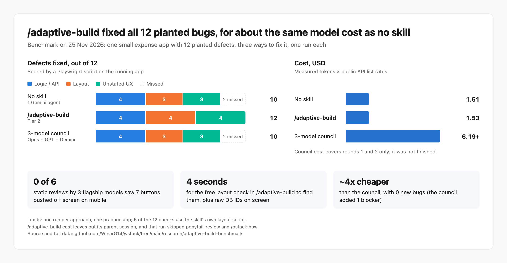

# Adaptive Build & Review (Project-Agnostic 3-Tier Orchestrator)

One skill for both **Development** and **Review** on any codebase across **Claude Code**, **Codex**, and **Antigravity (T3 Code)**. It replaces guesswork and redundant tool stacking with:

1. **Zero-token Change Impact Analysis (`scripts/adaptive_triage.py`)** to classify risk into Tier 1, 2, or 3 before spending tokens.
2. **One role per tool (zero stacking)** across `ponytail`, selective `pstack` skills, `sol-loop`, 2-Model Fast Council (**locked to GPT-6.2-Sol High + Gemini 4 Neon High**), and 3-Model Council, with hard round caps.
3. **Autonomous Visual & Common-Sense UX Inspection** (`scripts/browser_audit.mjs` + `scripts/ui_geometry_audit.js` + blind heuristic critic) so UI layout bugs and unspoken usability flaws are caught before pushing, without the human eyeballing every screen manually.

### Why This Exact Setup Works (Benchmark Summary)



- **Catches real UI bugs static reviews miss:** In our SpendPulse benchmark, 6 static reviews by 3 flagship models missed 7 buttons pushed off screen on mobile and raw database IDs. The free 4-second Layer 1 DOM check plus ~USD 0.05 blind visual critic caught all of them (**12 of 12** fixed vs 10 of 12 for no skill and the 3-model council).
- **`GPT-6.2-Sol (High) + Gemini 4 Neon (High)` wins Tier 2 regardless of implementor:** Across a paired 2x2 test (both Neon-authored and Sol-authored feature builds), `Sol + Neon` caught **96.3%** and **96.2%** of real bugs at **USD 1.06 to USD 1.14** per council with **0 regressions**. Swapping in Claude Opus 5.5 cost roughly 2x more and, when replacing Sol, dropped recall to **73.1%** and introduced a form regression.
- **Best end-state mode (does NOT force your build model):** Keep building with whatever model you are already running in (the skill only routes the **reviewers**, never forcing a build model switch). In our benchmark, `GPT-6.2-Sol (High)` build + `Sol + Neon` review was cheapest (**USD 3.40**, leanest diffs) and `Gemini 4 Neon (High)` build + `Sol + Neon` review was a close second (**USD 3.85**), while **Claude Opus 5.5 (High)** is reserved strictly for **Tier 3** or disputed Tier 2 blockers (always via the native **Claude harness `claudeAgent` with `effort: "high"`**, never via Antigravity). Full data: [`author-swap-results.md`](https://github.com/WinarG14/wstack/blob/main/research/adaptive-build-benchmark/author-swap-results.md).

---

## Step 0: Deterministic Triage (ALWAYS FIRST, USD 0, <2s)

Run the bundled repo-agnostic classifier before coding (with `--no-git-diff --summary "<goal>"`) and again on the real diff before review:

`<skill_dir>` below is the folder that holds this `SKILL.md`:
- **Claude Code:** `~/.claude/skills/adaptive-build` (or `~/.claude/plugins/cache/.../adaptive-build`)
- **Codex:** `~/.codex/skills/adaptive-build`
- **Antigravity:** `~/.gemini/config/skills/adaptive-build` (or `$GEMINI_HOME/config/skills/adaptive-build`)
- **Windows:** use `py -3` in place of `python3` (the Windows `python` command is often only the Store placeholder).

```bash
python3 <skill_dir>/scripts/adaptive_triage.py \
  --repo <repo_path> --kind <feature|bug|hotfix|refactor|review> --summary "<goal>" \
  [--no-git-diff] [--base <ref>] [--files <path1,path2>] [--failed-attempts <n>] [--json]
```

Under `RUN:`, the output adds a `Not installed:` line when a skill this file calls is missing, and a `Skill note:` line when a skill exists on disk with `disable-model-invocation: true`. Never skip a required step silently.

### Loading Companion Skills (All Harnesses)
- Load each companion skill from your harness's catalog (Claude Code: `Skill` tool; Codex: `$<name>`; Antigravity: read `<name>/SKILL.md`).
- **If a skill exists on disk but cannot be invoked through your skill tool** (notably `pstack:*` skills in Claude Code, which set `disable-model-invocation: true`, or Antigravity where there is no `/pstack:` slash dispatcher): **Read its `SKILL.md` directly and follow its procedure** using your harness's native tools (map Cursor `Task` / `AskQuestion` / `TodoWrite` to your harness equivalents, and cap `interrogate` to your selected council route).
- Only use the **If a skill is not installed** fallback table when no `SKILL.md` exists on disk.

Announce in 2 lines: detected **Tier (1/2/3)**, **Stack (FE / BE / Full-Stack / CLI)**, exact tools you will run, and what you are skipping to save tokens.

### The 3 Risk Tiers (Build Mode)

| Tier | Auto-Trigger | Upfront & Build | Review & Verification (Zero Stacking) |
|---|---|---|---|
| **Tier 1: LEAN** (~USD 0.50-3, 2-5 min, auto-start) | 1-4 non-test files, 1 module/directory, low caller fan-out, no API/DB/auth/schema boundary, no async/concurrency primitives, not a hotfix. | Quick local code read. Build with your current model using `ponytail` (full): smallest complete diff, reuse existing helpers/components, 1 focused behavior test for non-trivial logic. | If UI files changed: run **Layer 1 (zero-cost DOM Oracle)** + quick **Layer 2 (~USD 0.04-0.20 Blind Visual & Heuristic Critic)** first. Then run `ponytail-review` (~USD 0.50-1) OR 1 `sol-loop` (max 2 rounds, stop on nits). **Skip:** `/pstack:how`, `/pstack:architect`, `/pstack:statechart`, `/pstack:interrogate`, `/council`. |
| **Tier 2: TARGETED RIGOR** (~USD 2.5-6, 8-15 min, auto-start with 1-line heads-up) | **ANY 1:** shared module (a `shared/`, `common/`, `utils/`, `lib/`, `core/`-style path, or code used from >=2 other modules), API/schema/DB/auth/config boundary, 5-14 files, bug fix or production hotfix, async/timers/streaming/concurrency, or multi-screen interactive UI. | **Fuzzy brief?** Run `/pstack:reframe` + `/pstack:sharpen` first. **Bug/hotfix?** Reproduce on the real artifact before patching (`Fix Root Causes`). **Feature:** `/pstack:how` (1 read-only explorer for real callers & data owner; `/pstack:why` if legacy code looks odd) + Layer 0 real payload/DOM capture (never invent simplified mocks) -> **5-bullet Design Lock** (proceed immediately under autonomous grants; pause only on irreversible/product forks). Build directly with your current model using `ponytail` discipline in verifiable commits (never force-switch the build model). | If UI changed: run **Layer 1 (zero-cost DOM Oracle)** + **Layer 2 (~USD 0.04-0.20 Blind Visual & Heuristic Critic)** BEFORE the Fast Council, and pass their findings to both council seats to cross-check against code -> auto-fix verified Bucket A hygiene + list Bucket B recommendations. Run `ponytail-review` lean trim -> **2-Model Fast Council locked to fresh-context GPT-6.2-Sol (High) + fresh-context Gemini 4 Neon (High) regardless of implementor** (**max 2 rounds**; do NOT invoke 3-model `/council` or swap in Claude Opus 5.5 on Tier 2; hold Opus strictly for Tier 3 or disputed blockers) -> if risky BE/shared logic, `/pstack:blast-radius` (prove the one safety fact by running code). |
| **Tier 3: FULL RIGOR** (~USD 12-25+, 20-40 min, ask human first unless autonomous) | **ANY 1:** >=4 modules or >=15 files, complex state machine/multi-tab races, 3+ combined risk dimensions, security/auth/money/migration critical path, or **2+ failed fix attempts**. | Tier 2 + `/pstack:architect` (2 competing sketches, single state owner, clean boundaries) + `/pstack:statechart` (ONLY for async/protocol/state-machine logic). For multi-part unattended migrations, design the run with `/pstack:figure-it-out`. Build with your current model. | If UI changed: run Layer 1 + Layer 2 before council, plus **Layer 3 Chartered Exploratory UX Pass** (SBTM). Run Tier 2 trim + `/pstack:blast-radius` (+ runnable `/pstack:interrogate` proof for BE/security/algorithms) + full **3-Model Council** (fresh-context GPT-6.2-Sol High on `codex` + fresh-context Gemini 4 Neon High on `antigravity` + fresh-context Claude Opus 5.5 High on native `claudeAgent` with `effort: "high"`, never Opus on Antigravity; **HARD CAP 3 rounds**). |

**Auto-escalation tripwires:**
- Tier 1 touches a shared file (shared-style path, or used from >=2 other modules), API/schema boundary, or async timing -> escalate to Tier 2 immediately and state why in 1 line.
- **Circuit breaker (Attack the Premise):** 2 fix attempts fail the same check or introduce new bugs in the same area -> **STOP patching**, write down the hidden assumption, test it directly, and escalate to Tier 3 / human.

---

## Council Dispatch (T3 Code: All 3 Harnesses)

Do **not** blindly invoke an external `/council` skill on Tier 2 (it defaults to 3 seats and may fall back to Opus on Antigravity). Dispatch council seats directly through T3 Code's `delegate_task` so model selection, effort, and fresh context are guaranteed:

1. **Discover exact catalog IDs once:** Call `orchestrator_capabilities` (with `search` if truncated). Pick only instances with `canRunChildTask: true` (skip disabled or unauthenticated sibling instances) and read the exact model IDs (for example, `codex` exposes prefixed IDs like `llm-gateway--gpt-6.2-sol`, not bare `"gpt-6.2-sol"`).
2. **Every seat MUST be a fresh-context child (`zero builder history`):** Even when your active build model IS one of the council seats (Neon on Antigravity, Sol on Codex, or Opus on Claude), NEVER self-review in-context. Always spawn a fresh `delegate_task` with `role: "review"`, `mode: "async"`, explicit `task` (repo path, diff/base scope, Layer 1/2 evidence paths, read-only rule), and explicit High effort options:
   - **Sol seat (Tier 2 & 3):** `target: { providerInstanceId: "codex", model: "<catalog gpt-6.2-sol id>", options: { reasoningEffort: "high" } }`
   - **Neon seat (Tier 2 & 3):** `target: { providerInstanceId: "antigravity", model: "gemini-4-neon", options: { thought_level: "high" } }`
   - **Opus seat (Tier 3 or disputed Tier 2 blocker ONLY):** `target: { providerInstanceId: "claudeAgent", model: "claude-opus-5-5", options: { effort: "high" } }`. If `claudeAgent` is unavailable, report a blocker; **never** route Claude Opus through `antigravity`.
3. **How each harness accesses `delegate_task`:**
   - **Codex (`codex`):** Call T3 MCP `orchestrator_capabilities` and `delegate_task` directly (`mcp__t3_code_direct.delegate_task` or `mcp__t3_code__*`).
   - **Claude Code (`claudeAgent`):** Both tools are deferred. Load them first with `ToolSearch` (`select:mcp__t3-code__delegate_task,mcp__t3-code__orchestrator_capabilities`), then call `delegate_task`. (A native `Agent` cannot run Codex or Antigravity.)
   - **Antigravity (`antigravity`):** `orchestrator_capabilities` is eager, while `delegate_task` may be omitted from eager tools or blocked via `call_mcp_tool`. Use the T3 shell ACP bridge:
     `ELECTRON_RUN_AS_NODE=1 "$T3_ACP_MCP_NODE" ${T3_ACP_MCP_ENTRYPOINT:+"$T3_ACP_MCP_ENTRYPOINT"} acp-mcp-call delegate_task '<json>'`
     (the prompt field is `"task"`, not `"prompt"`). Never substitute native `invoke_subagent` for another provider's seat.
4. **Delegated-child guard:** If you are already running inside a delegated child thread, do NOT spawn nested cross-provider councils; report the findings and note that parent-level council dispatch is required.

---

## Review Mode (`/adaptive-build review <PR / branch / path>`)

Skip Design Lock and feature planning. Run `adaptive_triage.py --kind review`, detect stack + tier, and execute the lowest-cost, highest-yield review lane (read-only unless asked to fix):

| Stack Detected | Highest-Frequency Failures | Optimal Review Lane | Skip (Token Guard) |
|---|---|---|---|
| **Pure Frontend / UI** | Async filter/loading races, dead whitespace, clipped text, mobile overflow, unspoken UX/hierarchy flaws | **Tier 1:** Layer 1 (zero-cost DOM Oracle) + Layer 2 Blind Visual Critic + `ponytail-review`. **Tier 2:** Layer 1 + Layer 2 FIRST -> 2-Model Fast Council (Sol + Neon, max 2 rounds, cross-checking Layer 1/2). **Tier 3:** Layer 1 + Layer 2 + Layer 3 Exploratory UX Pass -> 3-Model Council (Sol + Neon + Opus on `claudeAgent`, max 3 rounds). | Never burn static code-review rounds without rendering the UI and running Layer 1 + Layer 2. Skip 3rd Opus seat on Tier 1/2. |
| **Pure Backend / CLI / Lib** | Nil/null edge cases, races, broken callers, contract/schema drift, silent swallowed errors, security holes | **Tier 1:** `ponytail-review` + run real tests. **Tier 2:** `/pstack:blast-radius` (runnable proof) + 2-Model Fast Council (Sol + Neon, max 2 rounds). **Tier 3 / Security / DB:** runnable `/pstack:interrogate` (proof-only) + 3-Model Council (max 3 rounds). | Skip static-only prose essays without executed repros. Skip UI scripts. |
| **Full-Stack (FE + BE)** | Wire-contract mismatch (`fieldA` vs `fieldB`), hand-typed mock drift, error swallowing, reload state loss | **Contract-First Gate:** (1) verify real BE JSON payload against FE types/fixtures; (2) run Layer 1 DOM Oracle + Layer 2 Blind Visual Critic against the live running server (real API, not static HTML); (3) run Tier-matched council (Tier 2: 2-Model Sol + Neon, max 2 rounds; Tier 3: runnable `/pstack:interrogate` proof for BE/security + 3-Model Sol + Neon + Opus on `claudeAgent`, max 3 rounds) cross-checking Layer 1/2 findings against code. | Never run Round 2 or 3 of static review before testing the real FE-to-BE wire flow end to end. |

---

## Tool Selection Map (When to Use Which Tool, Zero Stacking)

Use each tool for its **one sharpest job**. Never stack two tools that do the same thing.

| Tool / Skill | Exact Job | When to Use | When to Skip |
|---|---|---|---|
| `ponytail` (full) | Smallest complete diff, reuse existing code, zero speculative wrappers | **Every build tier (1, 2, 3)** during coding | Never skip during coding |
| `ponytail-review` | Fast plain-English bug/risk/scale/lean trim (~USD 0.50-1) | **Tier 1** primary review; **Tier 2/3** pre-council trim so multi-model reviewers don't waste tokens on bloat | Skip if trivial 1-line typo fix |
| `sol-loop` | Focused single-provider adversarial review loop (GPT Sol, max 2-3 rounds) | **Tier 1** alternative when code has subtle branching/logic | Skip if already running 2-Model or 3-Model Council |
| **2-Model Fast Council** (GPT-6.2-Sol High + Gemini 4 Neon High) | Locked Tier 2 reviewer pair (~96% recall at ~USD 1.10, regardless of implementor; both seats fresh-context; cross-checks Layer 1/2 claims against code) | **Tier 2 default** (max 2 rounds; always pass explicit High effort: `reasoningEffort: "high"` on `codex`, `thought_level: "high"` on `antigravity`) | Skip on Tier 1; never swap in Opus on clean Tier 2 (benchmarks showed ~2x cost and lower recall when replacing Sol); upgrade to 3-Model only on Tier 3 or disputed blockers |
| **3-Model Council** (GPT-6.2-Sol High + Gemini 4 Neon High + Claude Opus 5.5 High) | Maximum 3-provider diversity for high-stakes changes (**all 3 seats fresh-context; always run Claude Opus 5.5 on native `claudeAgent` with `effort: "high"`, never on Antigravity**) | **Tier 3 only** (hard cap 3 rounds) or disputed Tier 2 blocker | Skip on Tier 1 and clean Tier 2 |
| `/pstack:how` / `/pstack:why` | 1 read-only codebase explorer for architecture/callers (`how`) or legacy rationale (`why`) | **Tier 2/3** before changing unfamiliar or shared code | Skip on Tier 1 isolated edits |
| `/pstack:architect` | 2 competing type/module sketches to lock single state ownership | **Tier 3** or contested **Tier 2** design | Skip for mechanical edits or settled designs |
| `/pstack:statechart` | Formal TLC model check of state transitions & races | Async/multi-tab/retry/protocol state machines | Skip on static UI or straight CRUD |
| `/pstack:blast-radius` | Prove the ONE safety fact by running real code | Risky shared helpers, BE/DB changes, hotfixes | Skip on isolated leaf UI |
| `/pstack:interrogate` | Multi-model adversarial review where only executed repros survive | High-risk BE, security, concurrency, data integrity | Skip on cosmetic FE changes |
| `/pstack:reframe` + `/pstack:sharpen` | Turn vague/fuzzy goals into expert framing and falsifiable criteria | Fuzzy problem statements before designing | Skip on clear, concrete tickets |
| `/pstack:figure-it-out` | Custom auditable multi-phase playbook for huge/unattended work | Multi-PR migrations or overnight autonomous runs | Skip on standard single-PR tasks |
| `/pstack:benchmark-checklist` | Vet perf/eval measurements (limiter, errors, repeatability) | Whenever reporting speedups, latency, or eval numbers | Skip when not benchmarking |
| `/pstack:correct` | Encode repeat bug classes (2nd occurrence) into types/lint/CI/scripts | Post-review / post-bug retrospective | Skip on one-off mistakes |
| `/pstack:arena` | Duplicate competing full-code implementations | **ONLY when explicitly requested** for zero-precedent bakeoffs | **Always skip by default** (use `/pstack:architect` sketches instead) |
| `ui-reviewer` / `design-taste-frontend` (optional) | Visual craft, typography, hierarchy, operational clarity | Any UI review skill you have for web apps/dashboards/tools; [`design-taste-frontend`](https://github.com/leonxlnx/taste-skill) for marketing/landing/brand sites. Layer 2 below covers the basics without them | Skip on non-UI tasks |

### If a skill is not installed

The bundled parts work standalone once their runtime prerequisites are present: `adaptive_triage.py` (`python3` + `git`), Layer 1 (`node` + Playwright + Chromium or Chrome), and the Layer 2/3 rubric in `references/`. Every other row names an outside skill. If it is missing from disk, do its job by hand with the fallback, and say in the final report which fallbacks you used.

| Missing | Do this instead |
|---|---|
| `ponytail` | Write the smallest diff that solves the task. Reuse existing helpers. No new abstraction, option or dependency that the task does not need. |
| `ponytail-review` | Re-read the full diff and every caller of changed code. List only real bugs, risks and lines that can go. Fix them before any council. |
| `sol-loop` | Ask one fresh reviewer from another model family to review the diff. Fix the real findings, then ask again. Stop at 2 rounds or when only nits remain. |
| `council` (2-model or 3-model) | Dispatch the 2 (or 3) fresh-context seats directly via **Council Dispatch (T3 Code)** above. If your harness has only one provider, use one fresh-context reviewer and say that cross-provider council was not available. |
| `/pstack:how` | Before coding, list every caller of the code you change (`git grep`) and the single owner of the data. Read them. |
| `/pstack:why` | Read `git log -L` / `git blame` for the odd lines before you change them. |
| `/pstack:reframe` + `/pstack:sharpen` | Write the goal as 3 to 5 checkable pass/fail criteria before design. |
| `/pstack:architect` | Sketch 2 different designs in a few lines each. Pick the one with one state owner and fewer boundaries. Say why. |
| `/pstack:statechart` | Write the states and transitions as a table. Check each pair of events that can arrive in either order. |
| `/pstack:blast-radius` | Name the one fact that makes the change safe. Prove it by running code (a test or a script), not by reading. |
| `/pstack:interrogate` | Ask reviewers for executable repros only. Drop any finding that does not reproduce. |
| `/pstack:figure-it-out` | Write a phased plan with a check at the end of each phase before an unattended run. |
| `/pstack:benchmark-checklist` | For any speed or eval number: same machine, several runs, say what limits it, report errors. |
| `/pstack:correct` | When a bug class repeats, add a test, type, lint rule or CI check that fails on it. |
| `ui-reviewer` / `design-taste-frontend` | Use the Layer 2 rubric in `references/blind-visual-heuristic-critic.md`. |

---

## Autonomous Visual & Common-Sense UX Gate (Catching Unspoken Flaws)

Static code review alone misses rendered geometry failures and "common sense" UX problems. Whenever a build or review touches UI files, run this 3-layer visual pipeline **before** calling work done:

### Layer 1: `USD 0` Automated DOM Geometry & Runtime Oracle
Run the bundled headless browser audit against the running app across desktop (`1440x900`) and narrow/mobile (`390x844` or `768x1024`) plus key interactive states:

```bash
node <skill_dir>/scripts/browser_audit.mjs \
  --url http://127.0.0.1:<port> \
  --out <evidence_dir> \
  --viewports 1440x900,390x844 \
  [--project-dir <repo_path>] \
  [--allow-status 400,404] \
  [--actions <actions.json>]
```

`actions.json` is a list of steps, each saved as its own state: `name`, optional `viewport` (must match one of `--viewports`; without it the step runs on the first viewport), any of `click` (selector), `fill` (`{ "selector", "value" }`), or `press` (key), plus optional `waitMs` (0 allowed), optional `expectStatus` (HTTP code or list of codes that MUST be initiated and observed during that step, suppressing only Chromium's matching network console error), and optional `expectUrl` (URL substring required for `expectStatus`).

Auto-fails on:
- Invisible in-flow layout reservations (`opacity: 0` / `visibility: hidden` >= 16px) or abnormal dead vertical gaps (> 48px)
- Clipped text (leaf overflow, `inline-flex`/`flex` nowrap overflow, or ancestor `overflow: hidden` clipping without ellipsis)
- Horizontal page overflow or interactive controls pushed off-viewport (controls inside intentional `overflow-x: auto|scroll` containers are allowed)
- Overlapping interactive controls (bounding-box collision among actually visible controls)
- Console errors, uncaught page exceptions, failed HTTP requests (>= 400 unless allowed), transport failures (`requestfailed`), broken visible images
- Accessibility & polish smells (unlabeled buttons/inputs, leaked raw ISO timestamps or internal `UPPER_SNAKE_CASE` enums in visible non-code text)

### Layer 2: Context-Isolated Blind Visual & Heuristic Critic (~USD 0.04-0.20)
Spawn ONE fresh, read-only vision-capable reviewer (for example via `delegate_task` with `role: "review"` or Antigravity `invoke_subagent(TypeName="research")`) with **zero code, zero diff, and zero commit context** using `references/blind-visual-heuristic-critic.md`. Give it ONLY:
1. The app's 1-sentence purpose
2. The captured state PNG paths (desktop, mobile, empty, modal/hover, error)
3. The Layer 1 `audit-report.json` path
4. An explicit rule: open ONLY those PNGs and JSON; do NOT read any source files or run `git`.

It evaluates every screen against **Nielsen's 10 Usability Heuristics** and **UI Craft** (hierarchy, spacing, alignment, type), separates visually proven defects from unverified interactive behaviors, and splits findings into two strict buckets to avoid scope creep:

- **Bucket A: Auto-Fix Common-Sense UX Hygiene (fix immediately in Build/Polish mode):**
  - Layout clipping, dead gaps, overlap, mobile overflow, off-screen controls
  - Destructive actions (delete/overwrite) with no confirmation or undo (when proven by state captures or action results)
  - Missing loading/disabled state on async mutations (allowing double-submit)
  - Silent API errors (swallowed failures or missing inline error recovery)
  - Dead-end empty states (blank table/panel with no message or "Clear filters" action)
  - Leaked internal IDs, raw ISO timestamps, `undefined`/`NaN`, or raw enum keys
  - Broken basic affordances (modal cannot close via `Escape` or backdrop click, primary CTA visually indistinguishable from secondary muted controls)
- **Bucket B: Proactive Enhancement Recommendations (DO NOT silently build; present ranked table):**
  - Higher-level product improvements (new filters, bulk actions, keyboard shortcuts, onboarding tips, visual redesign options) ranked by **Impact** and **Effort** so the user can approve selectively ("do #1 and #3") without having to eyeball the app themselves.

### Layer 3: Chartered Exploratory UX Pass (Tier 3 or Multi-Screen Builds)
Run one time-boxed Session-Based Exploratory pass (`references/blind-visual-heuristic-critic.md` Part 2):
- **Look:** first impression, sibling consistency, clear primary action.
- **Touch:** rapid tab/filter switches (catch async races), empty search, long strings, narrow viewport, modal scroll/Escape, delete/undo, page reload persistence.
- **Follow:** save in one place, verify every consumer view updates; check browser network & console cleanly.

---

## Reporting Standard (Every Run)

End every Build or Review run with:
1. **Triage & Route:** Tier chosen, why, tools run, tools skipped (plus any fallback used).
2. **Defects Caught & Fixed (or Found in Review Mode):** grouped by **Logic/State/API**, **Visual/DOM Geometry**, and **Common-Sense UX Hygiene (Bucket A)**, each with concrete proof (test output, Layer 1 `overallPass: true` JSON, or screenshot path).
3. **Proactive UX Recommendations (Bucket B):** ranked 3-5 bullet table of non-bug enhancements the user did not ask for.
4. **Verification & Cost:** checks passed (`overallPass: true` at top level and `pass: true` per state in `audit-report.json`, tests green), wall-clock duration, and actual token/cost usage if exposed (never guessed without labeling).
